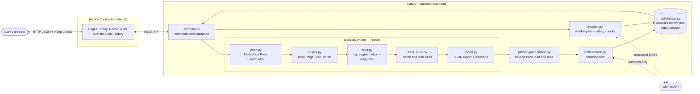
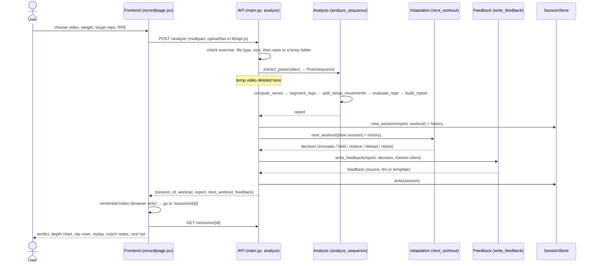

# LiftLens architecture and code guide

This document explains how LiftLens is put together: the components, what happens when a user uploads a set, what each module does, how data is stored, and why the main design choices were made. For setup and run instructions, see the [README](../README.md). For the LLM prompts and their inputs and outputs, see [`llm.md`](llm.md).

## 1. System overview



| Layer | Technology | Responsibility |
|---|---|---|
| Frontend | Next.js 16, React 19 (`frontend/`) | Upload with progress, results chart and replay, plan form, history. No secrets; talks only to the API. |
| API | FastAPI (`backend/api/`) | Validates uploads and fields, runs the pipeline, saves sessions, serves plans. |
| Video analysis | MediaPipe Pose + NumPy (`backend/analysis/`) | Video → per-frame landmarks → angle series → reps → per-rep verdicts → JSON report. |
| Adaptation | Pure Python rules (`backend/planning/`) | Session history → next session's load and reps, with a reason. |
| LLM features | Google Gemini via `google-genai` (`backend/llm/`) | Coaching text and weekly plans, validated by our code, with template fallbacks. |
| Storage | JSON files (`data/`, gitignored) | One file per session, plus the current plan. |

Only two parts are not our own code: the pretrained **MediaPipe Pose Landmarker** (dashed in the report's diagram), which turns each frame into 33 body landmarks, and the **Gemini API**, which writes text and proposes plans. Every decision (rep count, pass/fail, next load, plan safety) is made by our code.

## 2. What happens when a set is uploaded



Step by step, with the function that does each part:

1. **Upload** (`frontend/app/record/page.jsx`, `uploadSet` in `frontend/lib/api.js`). The form sends the video and the workout fields as multipart form data. `XMLHttpRequest` is used instead of `fetch` because it reports upload progress.
2. **Validation** (`analyze` in `backend/api/main.py`). It checks the exercise (`squat`), the file extension, the size limit (`LIFTLENS_MAX_UPLOAD_MB`), and the field ranges (RPE 1–10 and so on; invalid values get `422`). The upload is copied to a temporary folder in 1 MB chunks (`_save_upload`), and the folder is deleted as soon as pose extraction finishes.
3. **Pose extraction** (`extract_pose` in `pose.py`). OpenCV reads each frame and MediaPipe's Pose Landmarker (VIDEO mode) returns landmarks. We keep shoulders, hips, knees, ankles, wrists, and the nose, converted to pixels. Frames with no person are stored as `None`.
4. **Angle series** (`compute_series` in `angles.py`):
   - `_choose_side` picks the body side the camera sees best (highest visibility of hip, knee, and ankle).
   - For every frame where those joints are visible, it computes:
     - the **knee angle** (hip–knee–ankle), used to find reps;
     - the **thigh angle above parallel**, used for depth;
     - the **torso lean** from vertical;
     - **wrist height** relative to the nose;
     - **ankle position**.
   - Missing frames are filled by linear interpolation (`interpolate_missing`), and every series is smoothed with a centered moving average (`centered_moving_average`).
   - `shoulder_width_ratio` measures how far the camera is from side-on.
5. **Rep segmentation** (`reps.py`):
   - `adaptive_thresholds` sets *up* and *down* cutoffs from the person's own standing knee angle.
   - `segment_reps` runs a two-state machine: a rep starts below *down* and ends above *up*, and dips shorter than 0.4 s are ignored.
   - `split_setup_movements` drops dips where the hands are near or above the head at the deepest point, i.e. unracking or re-racking a bar.
6. **Form rules** (`evaluate_reps` in `form_rules.py`). For each rep, `deepest_frame` finds where the hips are lowest. The rep fails *shallow_depth* if the thigh is more than 15° above parallel there, and *forward_lean* if the torso is more than 50° from vertical.
7. **Report** (`build_report` in `report.py`, plus `downsample_trace` and `foot_travel` in `analyze.py`):
   - counts, per-rep results, and the form score (share of reps passed);
   - one coaching cue per fault type;
   - warnings: low visibility, camera not side-on, unsteady tracking, no reps;
   - ignored setup movements;
   - the thresholds used;
   - a 10-per-second trace of the knee and thigh angles for the charts.
8. **Next set** (`next_workout` in `planning/adaptation.py`). It applies the rules to the new set plus the saved history (see the table in the README): double progression within 8–12 reps, holds for form breakdown or RPE 9–10, reductions for missed reps or poor form, and a deload after two poor sessions.
9. **Coaching text** (`write_feedback` in `llm/feedback.py`). `feedback_input` builds a numbers-only JSON from the report and the decision. `GeminiClient.generate_json` asks Gemini for a reply in the `Feedback` schema, and `check_feedback` enforces the length limits. On any failure, `template_feedback` writes the same facts in fixed wording.
10. **Save and respond** (`SessionStore.write`). The session, with its decision and feedback, is written to `data/sessions/<id>.json` and returned.
11. **Results page** (`frontend/app/sessions/[id]/page.jsx`). It loads the session and draws the depth chart (`components/KneeTrace.jsx`): rep bands in green or red, setup bands in grey, the depth line, and a playhead synced to the video. It also shows the rep rows, coach notes, and the next set (`components/Prescription.jsx`). The video replays from the browser's memory (`lib/videoStore.js`), because the server never keeps it.

The plan flow is shorter:
1. `POST /plan` validates the `Profile`.
2. `generate_plan` asks Gemini for a `WeeklyPlan`.
3. `check_plan` tests it against the safety bounds. If anything fails, the LLM gets one retry with the violations listed, then `template_plan` is used.
4. `_with_form_check` marks which exercises can be video-checked.
5. `save_plan` stores the result in `data/plan.json`.

## 3. Module guide

### `backend/analysis/` (video → report)

| File | Main contents | Notes |
|---|---|---|
| `config.py` | `SquatConfig` | Every threshold in one frozen dataclass, each with a comment on what it means and how it was chosen. |
| `pose.py` | `extract_pose`, `Landmark`, `PoseSequence` | The only file that touches MediaPipe and OpenCV. Everything after it is plain NumPy, which is why the rest can be unit-tested without a model. |
| `smoothing.py` | `interpolate_missing`, `centered_moving_average` | Gap filling and smoothing; the window shrinks at the edges so the length is kept. |
| `angles.py` | `compute_series`, `SquatSeries`, `angle_at`, `torso_lean`, `_vertical_thigh_angle`, `shoulder_width_ratio` | All per-frame measurements (see section 5 for the depth measure). |
| `reps.py` | `adaptive_thresholds`, `segment_reps`, `deepest_frame`, `split_setup_movements`, `Rep` | Turns a series into rep spans and removes setup movements. |
| `form_rules.py` | `evaluate_reps`, `RepResult`, `CUES` | Per-rep pass/fail and the cue text for each fault. |
| `report.py` | `build_report` | Assembles the JSON report and all warnings. |
| `analyze.py` | `analyze_sequence`, `analyze_video`, `print_debug`, `main` | Wires the steps together; also the command-line tool (`--debug` prints the angle table). |

### `backend/planning/`

| File | Main contents | Notes |
|---|---|---|
| `adaptation.py` | `next_workout`, `AdaptConfig` | Pure function from session history (newest first) to a decision with `next` load/reps and a plain-language `reason`. |

### `backend/llm/`

| File | Main contents | Notes |
|---|---|---|
| `client.py` | `GeminiClient`, `get_llm_client`, `LLMError` | The only code that calls an external API. JSON mode with a schema; Pydantic validation; 20 s timeout; one retry on 429/500/503. Errors are reduced to type and status code, so request details and the key are never logged. Returns `None` when no key is set. |
| `feedback.py` | `write_feedback`, `feedback_input`, `check_feedback`, `template_feedback`, `FEEDBACK_SYSTEM_PROMPT` | Coaching text; the LLM explains decisions but never makes them. |
| `plan.py` | `generate_plan`, `check_plan`, `template_plan`, `Profile`, `WeeklyPlan`, `LIBRARY`, `BOUNDS` | Weekly plan with safety checks, retry, and fallback. |

### `backend/api/`

| File | Main contents | Notes |
|---|---|---|
| `main.py` | `create_app` and the endpoints | `create_app(settings, llm)` takes its dependencies as arguments, so tests can pass a temporary data folder and a fake (or no) LLM. `/analyze` is a plain `def`, so FastAPI runs it in a worker thread and pose extraction doesn't block the server. |
| `storage.py` | `SessionStore` | JSON-file storage. Session ids are uuid4 hex and are checked against a pattern before any file access, which blocks path tricks like `../`. |
| `settings.py` | `Settings.from_env` | Reads `LIFTLENS_*` variables and `.env`. |

### `frontend/`

| Path | What it is |
|---|---|
| `app/layout.jsx`, `components/Nav.jsx`, `app/globals.css` | Page frame, navigation, and the whole visual system. Colors follow competition weight plates: green = passed, red = failed, yellow = warning, blue = action. |
| `app/page.jsx` | Today: next set, last set's mini chart, form over time, the week. Different first-visit content when there's no data. |
| `app/record/page.jsx` | Upload form with drag-and-drop, preview, progress, and filming tips. Pre-filled from the next set. |
| `app/sessions/[id]/page.jsx` | Results: verdict, warnings, depth chart, video with per-rep replay, rep rows, coach notes, next set. |
| `app/plan/page.jsx`, `app/history/page.jsx` | Plan form and weekly view; table of all sets. |
| `components/KneeTrace.jsx`, `MiniTrace.jsx`, `FormHistory.jsx`, `Prescription.jsx`, `Notice.jsx` | Charts and shared blocks (SVG, no chart library). |
| `lib/api.js`, `lib/format.js`, `lib/videoStore.js` | API calls with readable errors, shared wording, and the in-browser video store. |

### Tests and scripts

| Path | What it is |
|---|---|
| `backend/tests/synthetic.py` | Builds stick-figure pose sequences with exact, known geometry: knee angle, thigh share, lean, hands up for setup movements, foot wobble, camera offset. The analysis tests need no video or model because of this. |
| `backend/tests/test_*.py` | 150 tests: analysis, API (pose step replaced by the generator), adaptation scenarios, and LLM features with a fake client. |
| `scripts/evaluate.py` | Accuracy on labeled real clips (`samples/labels.csv`): rep counts, per-fault precision/recall/F1, and timing. |
| `scripts/sample_result.py` | One synthetic set through the whole backend; prints the result. |
| `scripts/check_llm.py` | Live check that the Gemini key and model work. |
| `scripts/download_model.py` | Downloads the pose model to `models/`. |

## 4. Data model

A saved session (`data/sessions/<session_id>.json`), shortened:

```json
{
  "session_id": "5155c81ee32d4843abde0f48361a3908",
  "created_at": "2026-11-20T19:06:12.123456+00:00",
  "workout": {"load": 45.0, "unit": "lb", "target_reps": 3, "rpe": 7},
  "report": {
    "exercise": "squat",
    "rep_count": 3, "reps_passed": 0, "form_score": 0.0,
    "reps": [{"number": 1, "start_time": 2.33, "bottom_time": 4.03, "end_time": 4.93,
              "bottom_thigh_angle": 21.8, "bottom_knee_angle": 84.0,
              "torso_lean_at_bottom": 29.4, "errors": ["shallow_depth"], "passed": false}],
    "cues": ["Reps 1, 2, 3: Squat deeper: lower until your thighs are about parallel to the floor."],
    "warnings": [],
    "ignored_movements": [{"start_time": 11.63, "end_time": 12.17,
                           "reason": "setup movement (hands up on a racked bar)"}],
    "camera": {"shoulder_width_ratio": 0.26, "foot_travel": 0.16},
    "thresholds_used": {"standing_baseline": 175.8, "up": 160.0, "down": 140.0},
    "thresholds": {"max_thigh_above_parallel": 15.0, "max_torso_lean": 50.0, "...": "..."},
    "trace": {"t": [0.0, 0.1, "..."], "knee": [162.8, "..."], "thigh": [88.1, "..."], "lean": [19.0, "..."]}
  },
  "next_workout": {"decision": "reduce", "next": {"load": 40.0, "unit": "lb", "target_reps": 3},
                   "reason": "None of the reps had good form. Reduce to 40 lb and keep 3 reps.", "...": "..."},
  "feedback": {"summary": "...", "tips": ["..."], "next_session": "...", "source": "llm",
               "model": "gemini:gemini-3.5-flash-lite"}
}
```

`data/plan.json` holds the profile, the plan (days → exercises with sets, reps, rest, and `form_check`), its source (`llm` or `template`), and a timestamp. Videos are never stored.

## 5. Key design decisions

| Decision | Why |
|---|---|
| **Analysis on a Python server, not in the browser** (Phase 1 planned in-browser) | Faster to build, test, and debug with NumPy and pytest. Privacy is kept by deleting each upload right after pose extraction; only measurements are saved. |
| **Pretrained pose model + our own rules, not a trained classifier** | A team-sized labeled dataset would be far too small to train on. Rules on top of pose landmarks are explainable ("thigh 22° above parallel"), adjustable in `config.py`, and testable with synthetic data. |
| **Thresholds adapt to each person's standing knee angle** | A fixed "standing = above 160°" never finished a rep for a lifter who stood with soft knees (found on a test clip). |
| **Depth from heights, not the on-screen knee angle** | Turning the camera around the lifter shrinks horizontal distances, which distorts the 2D knee angle; heights don't change. On our bad-form clip the knee angle read 84–94° (looks deep) while the thighs were 22–28° above parallel. `test_depth_check_survives_angled_camera` covers this. |
| **Setup filter from hand height** | Ducking under a racked bar is a deep knee bend; the original version counted unracking and re-racking as reps (4, 6, and 4 reps on 3-rep clips). In a back squat the hands stay at shoulder height, while under a racked bar they're above the head. |
| **Warn about unsteady tracking instead of guessing** | When plates or the rack hide the hips, MediaPipe still reports high confidence, so its visibility score can't be trusted. The feet should stay planted, so apparent foot movement is used as the signal. |
| **Rule-based adaptation; LLM only for wording and plan proposals** | Load decisions affect safety, so they need to be predictable and testable. The LLM's output is validated against a schema and safety bounds, and every LLM feature has a template fallback, so the app runs with no API key. |
| **JSON files for storage** | Nothing to install for graders; `SessionStore` is the only class that touches storage, so a database can replace it later. |
| **Dependency injection in `create_app`** | Tests run the real API with a temporary data folder, the pose step replaced by synthetic data, and no LLM, so they never call the network. |

## 6. Testing strategy

| Level | How | Where |
|---|---|---|
| Geometry and signal processing | Exact synthetic figures with known angles | `test_analysis.py` |
| End-to-end analysis logic | Synthetic sets through `analyze_sequence`: counts, faults, angled camera, setup movements, tracking warning | `test_analysis.py` |
| API | FastAPI `TestClient`; pose step patched; every error code | `test_api.py` |
| Adaptation | Fake session histories for every rule | `test_adaptation.py` |
| LLM features | Fake client: parsing, retries, fallbacks, numbers-only prompt; template plan checked for all 72 profile combinations | `test_llm.py` |
| Real-world accuracy | Labeled team clips | `scripts/evaluate.py` → `docs/eval_results.json` |
| Live LLM | Real Gemini call | `scripts/check_llm.py` |
